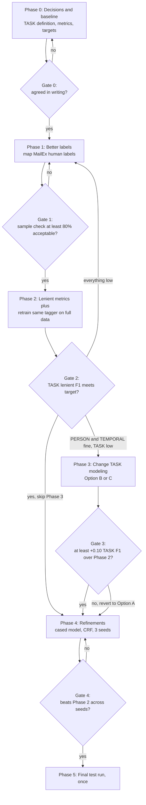
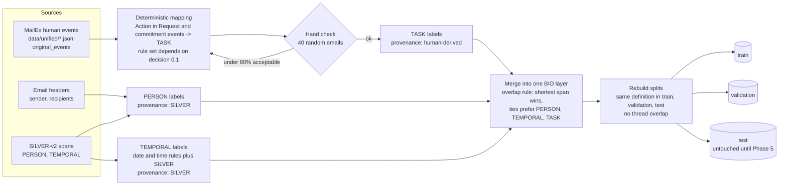
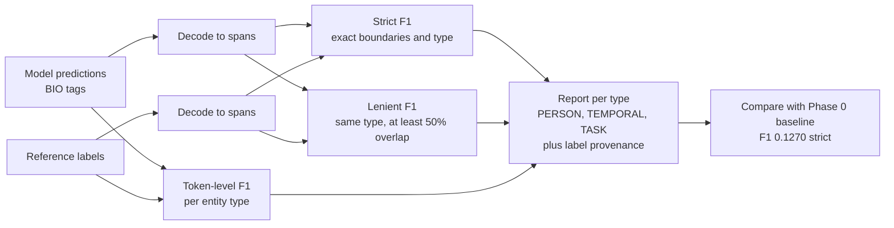
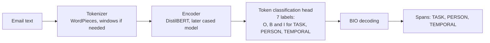
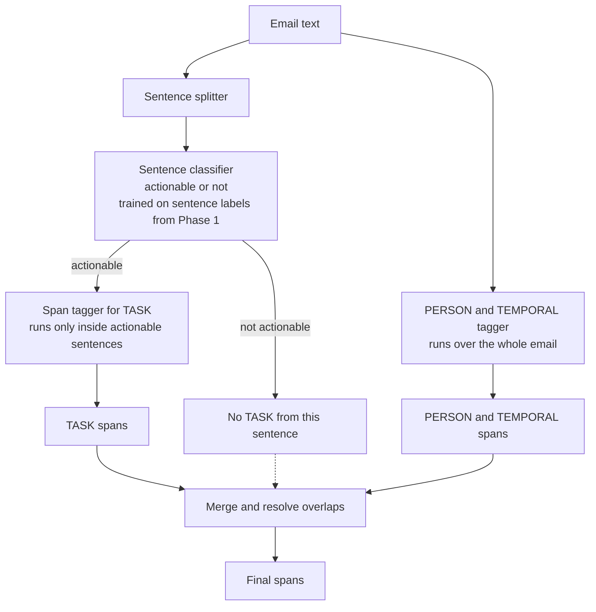
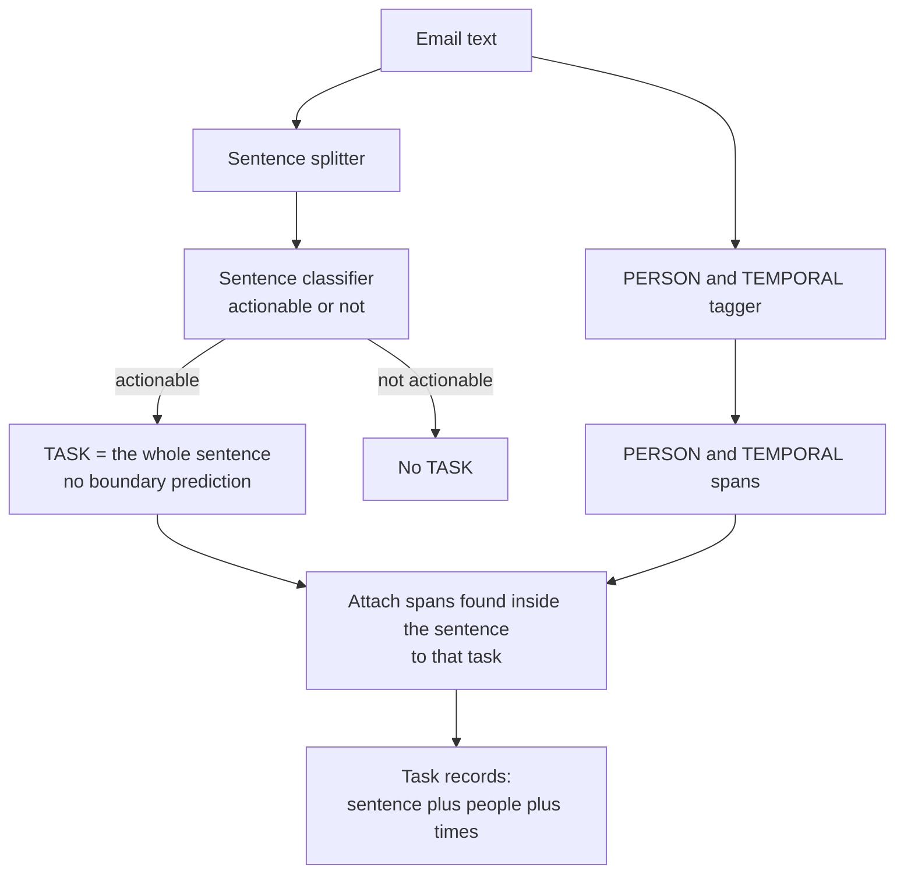
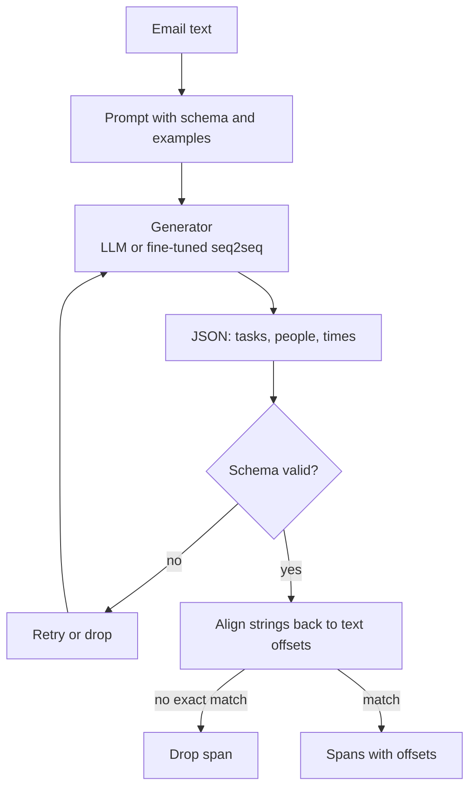
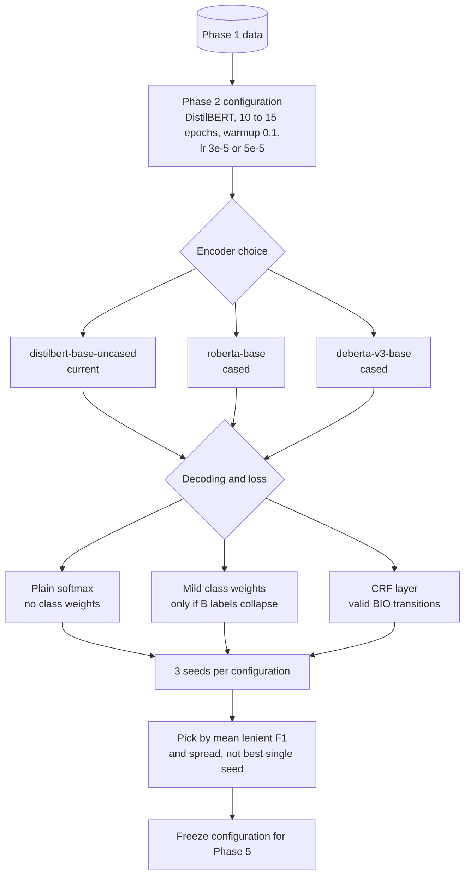
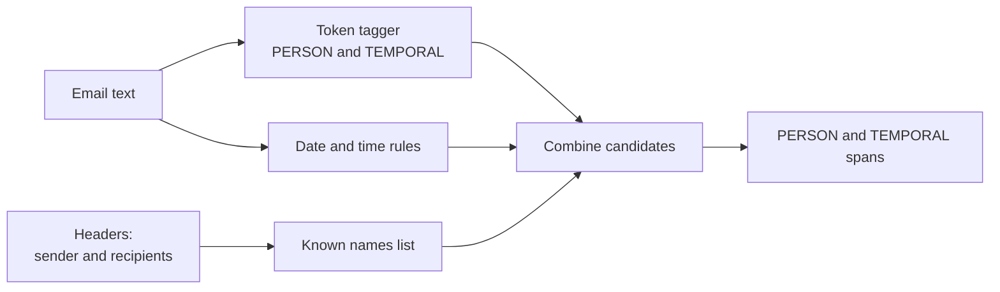

# Architecture Diagrams for plan_model.md

One diagram for every design in the plan, so you can choose. **Nothing here is built yet.**

Contents:

0. Overall plan with gates
1. Phase 1: label building
2. Evaluation (Phase 0.2 and 2.1)
3. TASK Option A: token tagging (default)
4. TASK Option B: sentence classifier plus span extraction
5. TASK Option C: sentence-level TASK only
6. TASK Option D: generative extraction
7. Phase 4: model and training refinements
8. PERSON and TEMPORAL branch (used by A, B and C)

---

## 0. Overall plan with gates

---

## 1. Phase 1: label building

---

## 2. Evaluation

---

## 3. TASK Option A: token tagging (default, no change in design)

Trade-off: one model and no new code. TASK may plateau because meaning, not word shape, decides it.

---

## 4. TASK Option B: sentence classifier plus span extraction

Trade-off: better at request vs past event, fewer false spans. Two or three models to train and keep consistent. An error in the classifier is passed on to the span tagger.

---

## 5. TASK Option C: sentence-level TASK only

Trade-off: removes the boundary problem and is the simplest to evaluate, but TASK output is coarser. Downstream code must accept sentences, not exact spans.

---

## 6. TASK Option D: generative extraction (not recommended now)

Trade-off: flexible, but the earlier local run took over 4 hours for 44 valid records, and invalid or unaligned outputs are common. Hardest to evaluate.

---

## 7. Phase 4: model and training refinements

---

## 8. PERSON and TEMPORAL branch

Used by Options A, B and C.

The rules and header lookup are optional helpers. Keep them only if they improve lenient F1 in Phase 2 or 4.
