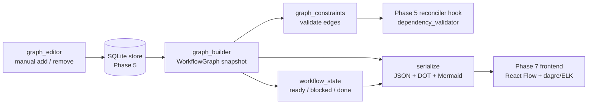

# Phase 6 Plan — Dependency Graph and Workflow State

**Status:** Draft for your approval. Nothing in this plan has been implemented.
**Source:** `remaining_phases.md` §7, `vis_plan.md` §5.4, and the Phase 4 and 5 code as it stands today.
**Goal:** Turn the accepted task-to-task dependencies stored by Phase 5 into a **validated directed acyclic graph**, and derive from it which tasks are *ready*, *blocked* or *done*. A bad edge, such as a cycle, a self-link or a dangling endpoint, is refused with a recorded reason and never silently dropped. The graph serialises into a stable JSON contract that Phase 7's frontend draws.

---

## 1. Technologies used (please review this section first)

| Layer | Technology | Status | Used for | Alternatives I considered |
|---|---|---|---|---|
| **Graph data structure and algorithms** | **NetworkX 3.7** (`nx.DiGraph`) | **Already installed** in `.venv` | The in-memory directed graph, cycle checks, ancestors/descendants, topological ordering, layering | `igraph`, `rustworkx`, `graph-tool`: faster, but we have hundreds of nodes at most, and NetworkX is what `remaining_phases.md` and `vis_plan.md` already specify. A graph database (Neo4j): overkill and a heavy install for a local MVP |
| **Persistence (source of truth)** | **SQLite** via stdlib `sqlite3`, the Phase 5 `dependencies` and `history` tables | Already built | Edges and their history. The graph is a **derived view rebuilt from SQLite**, never a second copy of the truth | A persistent graph store. It would duplicate state and break the single append-only history |
| **Language and data classes** | Python 3.12 stdlib (`dataclasses`, `typing`) | Existing | Result and decision objects, JSON-serialisable | `pydantic`: not installed, and not needed for internal objects. The Phase 7 API layer can add it |
| **Numeric helpers (optional)** | `scipy 1.18` (`scipy.optimize.milp`) | Already installed | *Only* for the optional extension E5 (exact acyclic edge selection on small cyclic components) | Hand-written brute force or greedy only. I'd use these first and keep scipy as an exact check |
| **Serialisation contract** | Plain **JSON** (node/edge lists shaped for React Flow), plus **DOT** and **Mermaid** text exporters | New code, no library | The Phase 7 frontend contract. DOT and Mermaid are debug and report text, with no rendering library | Rendering PNGs with `matplotlib`/`graphviz`: neither installed, and drawing is Phase 7's job |
| **Testing** | stdlib `unittest` plus seeded random fuzzing | Existing pattern | Unit tests, a brute-force oracle for cycle detection and for blocked/ready states, invariant fuzzing | `hypothesis`: not installed, and the seeded fuzz in Phase 5 worked |
| **Frontend (Phase 7, NOT built here)** | **React Flow (`@xyflow/react`)** for interaction, **dagre** or **ELK** for layout | Specified in `vis_plan.md`; **not installed, not used in Phase 6** | Listed so you can see the whole chain. Phase 6 only guarantees the JSON it will consume, plus a topological `layer` as a layout hint | Cytoscape.js, vis-network, D3 force layout |

**Net effect: Phase 6 adds no new package.** NetworkX, SciPy and NumPy are already in the environment. If you later want a library I haven't listed, the environment has `uv` available for installs (the venv has no `pip`).

### NetworkX operations I plan to use

| Need | NetworkX call | Cost |
|---|---|---|
| Would a new edge create a cycle? | `nx.has_path(G, dependent, prerequisite)` (a new edge `prerequisite → dependent` closes a cycle exactly when a path already runs `dependent ⇝ prerequisite`), and `nx.shortest_path` to *name* the cycle in the rejection reason | O(V+E) |
| Is the stored graph acyclic? | `nx.is_directed_acyclic_graph`, and `nx.find_cycle` to diagnose | O(V+E) |
| Predecessor and dependent queries | `G.predecessors`, `G.successors`, `nx.ancestors`, `nx.descendants` | O(V+E) |
| Execution order and layers | `nx.topological_sort`, `nx.topological_generations` | O(V+E) |
| Redundant (transitive) edges | `nx.transitive_reduction` | O(V·E), fine at this scale |
| Longest chain (optional, for display) | `nx.dag_longest_path` | O(V+E) |
| What-if validation | `G.copy()` then mutate the copy | O(V+E) |

**Scale assumption:** a workspace has at most a few hundred tasks and a few hundred edges. At that size every call above is effectively instant, so the graph is rebuilt per request with no incremental maintenance and no cache to invalidate.

---

## 2. What the repo check found

| Finding | Evidence | Consequence |
|---|---|---|
| Phase 5 already stores edges with `dependent_task_id`, `prerequisite_task_id`, `status` (proposed/accepted/rejected), evidence, source message, source kind and reason, and accepts a pluggable `dependency_validator(store, ws, dependent, prerequisite) -> (ok, reason)`. The default is a placeholder: endpoints exist and no self-loop. | `reconciler.py` | Phase 6 supplies the real validator through that existing hook. No Phase 5 schema change is needed. |
| Phase 5 history records dependency changes on the dependent task. | `_apply_dependency` | Manual add/remove follows the same path, so edge changes are traceable. |
| **There is almost no real dependency data.** In the labelled data the only DEPENDS_ON examples are 4 train and 3 test, all TASK→EVENT, which the three-class entity model cannot produce. In the Phase 5 corpus replay there were 0 `ADD_DEPENDENCY` proposals, 7 unmatched-endpoint flags and 1 self-dependency flag. | Phase 3 audit, Phase 5 report | Graph quality **cannot be measured on real data**. Evaluation is functional only: scripted multi-user chains, brute-force oracles, fuzzing. I will say so in the report. |
| `vis_plan.md` requires: edges drawn prerequisite → dependent, blocked-node highlighting, "hold invalid edge for review rather than silently dropping it", solid (accepted) vs dashed (suggested) edges, and never inferring edges from chronological order. | `vis_plan.md` §5.4 | These become explicit requirements and tests below. |

---

## 3. Decisions to confirm before implementation

Each has a default. Tell me which to change.

1. **Graph library: NetworkX only.** *(default; igraph and rustworkx rejected as unnecessary at this scale)*
2. **The graph is a derived, in-memory view.** SQLite stays the single source of truth. *(default)*
3. **Edge statuses stay `proposed / accepted / rejected`.** An edge that would create a cycle is stored as `rejected` with a reason code and the cycle path, shown to the user as "held for review", and **never deleted**. No new status. *(default)*
4. **Cancelled prerequisite.** The dependent is shown as `blocked_cancelled_prereq` ("needs review"), never automatically unblocked, as the roadmap says. *(default)*
5. **Timing conflicts are warnings, not rejections.** For example, a prerequisite due after the dependent. Only *resolved* dates are compared, and a dependency is **never created from date order**. *(default)*
6. **Transitive-redundant edges are accepted and flagged**, not removed. *(default)*
7. **A completed dependent whose prerequisite is still open** is accepted but flagged `INCONSISTENT_COMPLETION`. *(default)*
8. **No EVENT or external-prerequisite nodes in the MVP.** There is no EVENT detector. Edges connect tasks only. *(default; the roadmap allows EVENT nodes "when supported")*
9. **Cross-thread edges allowed** within one workspace. *(default)*
10. **Manual edges** (a user adds or removes an edge) go through the same validator, history and idempotency path, with `source_kind = "human"`. *(default)*
11. **Optional extension E5 (consistency-aware edge selection).** Implement a small version, off by default, evaluated **only on synthetic graphs** (never claimed as a semantic F1 gain). *(default: include; say "skip" if you prefer to leave it out)*
12. **Rendering stays in Phase 7.** Phase 6 emits JSON, a layout-hint `layer`, and DOT/Mermaid text. *(default)*

---

## 4. Graph contract

- **Nodes** are Phase 5 task ids.
- **Direction:** `T2 DEPENDS_ON T1` is the graph edge **`T1 → T2`** (prerequisite → dependent). Phase 5's `prerequisite_task_id → dependent_task_id` maps one-to-one.
- **Edge attributes:** `edge_id`, `status`, `evidence`, `source_message_id`, `source_kind` (neural/rule/scripted/human), `score` (uncalibrated, if present), `reason`, `warnings[]`, `redundant`.
- **Two graphs from one store:**
  - the **strict graph** is the accepted edges only. It is **always acyclic**, and it is what blocked/ready is computed from;
  - the **review layer** is proposed and rejected edges. These are kept, serialised and shown, but they never affect derived states.
- **Task state** is the stored lifecycle status (`open`, `in_progress`, `completed`, `cancelled`). **Derived readiness** is computed, never stored:

| Derived state | Rule |
|---|---|
| `done` | lifecycle `completed` |
| `cancelled` | lifecycle `cancelled` |
| `blocked` | not closed, and at least one accepted prerequisite is `open` or `in_progress` |
| `blocked_cancelled_prereq` | not closed, no incomplete prerequisite, but at least one accepted prerequisite is `cancelled` (needs review) |
| `ready` | not closed, and every accepted prerequisite is `completed` (or there are none) |

  Each node also lists `blocked_by` (direct prerequisites not completed) and `root_blockers` (ancestors that are incomplete and not themselves waiting on anything, which is "what to do first").

---

## 5. Steps

### Step 1 — Module layout and data objects (`src/graph/`)



Result objects: `EdgeDecision` (accepted/rejected, reason code, cycle path, warnings), `NodeState`, `GraphSnapshot`, `StateDiff`.

### Step 2 — Graph builder (`graph_builder.py`)

`WorkflowGraph.from_store(store, workspace)` loads tasks and edges and builds the strict `nx.DiGraph` plus the review layer. If the stored accepted edges already contain a cycle (for example from the Phase 5 placeholder validator), it **does not crash**: it reports `acyclic = False`, lists the offending edges, and keeps building the rest so the problem is visible. It exposes the queries from the table in §1, and `topological_order()` returns an order **only** for the acyclic strict graph.

### Step 3 — Edge validation (`graph_constraints.py`)

`validate_new_edge(snapshot, prerequisite, dependent) -> EdgeDecision`:

| Check | Outcome |
|---|---|
| Self-dependency | rejected (`SELF`) |
| Unknown or cross-workspace endpoint | rejected (`UNKNOWN_ENDPOINT`) |
| Edge already accepted | rejected (`DUPLICATE`) |
| Would create a cycle | rejected (`CYCLE`) with the path `T3 → T1 → T2` named in the reason; accepted state is untouched |
| Prerequisite cancelled | accepted with warning `PREREQUISITE_CANCELLED` |
| Dependent already completed while the prerequisite is open | accepted with warning `INCONSISTENT_COMPLETION` |
| Both dates resolved and prerequisite due after dependent | accepted with warning `PREREQUISITE_DUE_AFTER_DEPENDENT` |
| Edge is implied by a longer path | accepted with warning `REDUNDANT_TRANSITIVE` |

`make_dependency_validator()` returns the callable that Phase 5's `Reconciler(dependency_validator=...)` expects, so chat-derived dependencies get the same checks as manual ones. No Phase 5 code needs rewriting.

### Step 4 — Workflow state (`workflow_state.py`)

`compute_states(snapshot) -> {task_id: NodeState}` per the table in §4. `diff_states(before, after) -> StateDiff` lists tasks that became ready, became blocked, or need review. `impact_of(snapshot, task_id, new_status)` is a pure what-if ("completing T1 would unblock T2"), which Phase 7 can show on a review card before anyone accepts.

### Step 5 — Manual edits and re-review (`graph_editor.py`)

- `add_dependency(...)` and `remove_dependency(...)` use one transaction with the version/idempotency path from Phase 5, write history on the dependent task, and set `source_kind = "human"`.
- `remove_dependency` marks the edge `rejected` with reason `removed by <actor>`, so the evidence survives.
- `reconsider(edge_id)` re-runs validation on a held (rejected) edge, for example after another edge was removed and the cycle is gone.

### Step 6 — Serialisation (`serialize.py`)

Deterministic, sorted output that the frontend can use directly:

```json
{
  "nodes": [{"id": "T-1", "title": "...", "owner_id": "bianca", "status": "completed", "derived_state": "done",
             "blocked_by": [], "root_blockers": [], "due": "2026-11-13", "layer": 0, "source_message_id": "m1", "version": 3}],
  "edges": [{"id": "E-ab12", "source": "T-1", "target": "T-2", "kind": "accepted", "evidence": "...", "source_message_id": "m3",
             "source_kind": "human", "score": null, "reason": "", "warnings": [], "redundant": false}],
  "meta": {"acyclic": true, "node_count": 3, "accepted_edges": 2, "proposed_edges": 0, "held_edges": 1, "schema": "phase6-v1"}
}
```

`kind` is `accepted` (solid), `proposed` (dashed) or `held` (rejected, with its reason). `layer` is the topological generation, a layout hint for dagre/ELK. `to_dot()` and `to_mermaid()` produce plain text for reports and debugging.

### Step 7 — Phase 5 integration

- Wire `make_dependency_validator()` as the default in `scripts/run_phase5_pipeline.py` and `evaluate_phase5.py`. `Reconciler`'s own default stays as the lightweight fallback.
- Phase 3, 4 and 5 outputs are consumed unchanged.

### Step 8 — Optional E5: consistency-aware edge selection (`graph_constraints.py`, off by default)

Given a set of *candidate* edges with scores, choose the highest-total-score subset that is acyclic:
- **Baseline:** accept edges one by one in score order if each keeps the graph acyclic (order-dependent).
- **E5:** minimum-weight feedback-arc removal inside each strongly connected component: exact by enumeration for small components, a greedy heuristic otherwise, with scipy's `milp` as an exact cross-check.
- Evidence and thresholds are held fixed. Report **incorrect edges removed** and **correct edges lost**, on **synthetic graphs with known injected cycles only**. There is no real dependency data, so no semantic accuracy claim will be made.

---

## 6. Evaluation (functional; no labelled dependency data exists)

1. **Oracle tests:** random digraphs checked against an independent brute-force DFS: cycle-acceptance decisions, the strict graph being a DAG after any sequence of adds, every edge respecting the topological order, and derived `ready/blocked/done` states against a naive independent recomputation.
2. **Scripted scenario suite** (about 15), including:
   - a three-person chain where completing the prerequisite unblocks the next task and *only* that task;
   - a proposed cycle that is held with its path while accepted state stays unchanged;
   - a cancelled prerequisite, which gives `blocked_cancelled_prereq` and does not auto-unblock;
   - self, duplicate, unknown-endpoint, redundant, timing-conflict and completed-dependent cases;
   - removing an edge unblocks a task;
   - chat-driven dependencies (reusing Phase 5 scenarios) passing through the real validator;
   - a manual add and remove with history.
3. **Invariant fuzz** (seeded, same style as Phase 5): random adds, removes, completions, cancellations and replays. After every step the strict graph is acyclic, no edge is deleted, derived states agree with the oracle, and serialisation is deterministic.
4. **Reported numbers** (all functional): accepted-graph cycles and constraint violations (target 0), blocked/ready agreement with the oracle, rejected edges that carry a reason (target 100%), and unresolved or held edges. **Accepted-edge precision/recall cannot be computed** (no reference edges). The report will state that graph validity is not semantic accuracy.
5. **Corpus note:** the report will give the real-corpus edge count (currently effectively zero) so nobody mistakes the demo graphs for learned structure.

## 7. Deliverables

```
src/graph/__init__.py, graph_builder.py, graph_constraints.py, workflow_state.py, graph_editor.py, serialize.py
tests/test_graph_builder.py, test_graph_constraints.py, test_workflow_state.py, test_graph_editor.py,
tests/test_graph_oracle.py, test_graph_serialize.py
tests/fixtures/graph_scenarios.json
scripts/evaluate_phase6.py, scripts/run_phase6_demo.py     (prints JSON + Mermaid for a scripted chain)
configs/phase6.json                                        (warning severities, E5 switch)
results/phase6/REPORT.md, report.json, demo_chain.mmd
```

## 8. Acceptance criteria

- [ ] `T2 DEPENDS_ON T1` is stored and serialised as edge `T1 → T2`, with evidence, source message and source kind on every edge.
- [ ] The strict graph is acyclic after every operation. A cycle-forming edge is refused with its path named, accepted state is unchanged, and the edge is kept (not deleted).
- [ ] Completing a prerequisite unblocks exactly its dependents, and removing an edge recomputes states correctly. A cancelled prerequisite never auto-satisfies a dependent.
- [ ] No dependency is ever created from date order alone.
- [ ] Phase 5 chat-derived dependencies pass through the same validator as manual ones.
- [ ] Serialisation is deterministic and matches the contract in Step 6.
- [ ] The existing 207 tests still pass.

## 9. Risks

| Risk | Mitigation |
|---|---|
| No real dependency data, so the demo can look better than the learned system is. | Say so in the report. Label every graph as scripted or live. Report the real-corpus edge count. |
| Stored data may already contain a cycle (the Phase 5 placeholder validator allowed one). | The builder reports and isolates it and never crashes. A test covers this. |
| Rebuilding per request could look wasteful. | Fine at hundreds of nodes. Measured in the tests, and no cache is added. |
| Over-warning (timing, redundancy) makes edges look unreliable. | Warnings are info/warn only, carry codes, and severities are configurable. |
| E5 could be mistaken for a semantic improvement. | It is optional, synthetic-only, and the report states that it measures constraint handling, not extraction accuracy. |

## 10. Order and checkpoints

1. Steps 1 to 3 (builder, validation) with tests. **Checkpoint:** cycle decisions agree with the brute-force oracle.
2. Steps 4 and 6 (states, serialisation).
3. Steps 5 and 7 (manual edits, Phase 5 hook). **Checkpoint:** the scenario suite, including the three-person chain, passes.
4. Step 8 (E5, if kept), then evaluation, fuzz and the report, and a full test run.

**Out of scope:** any frontend rendering or layout (Phase 7), the API, EVENT/external nodes, learning dependency edges from data, automatic edge acceptance, and any human-reviewed GOLD data.
