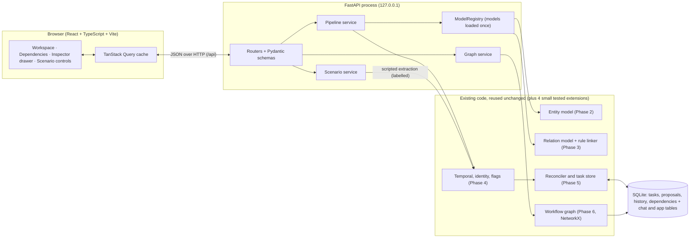
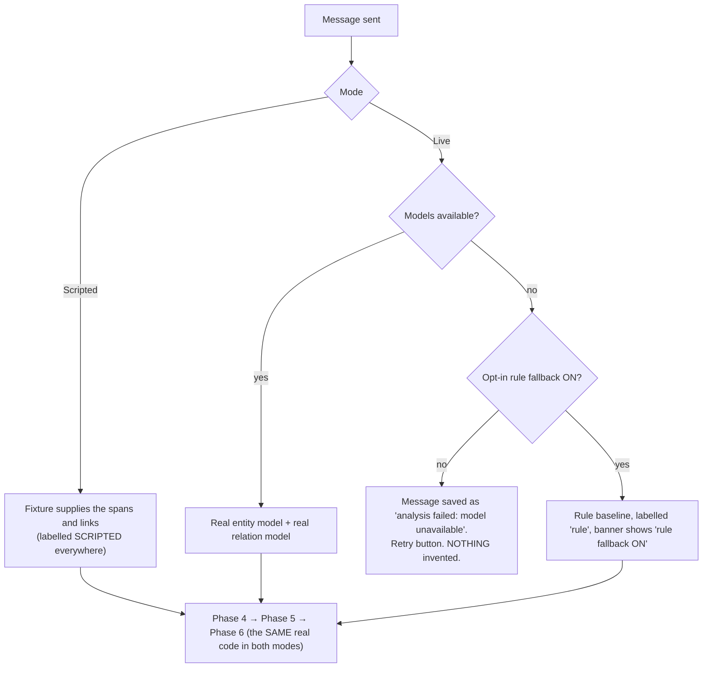
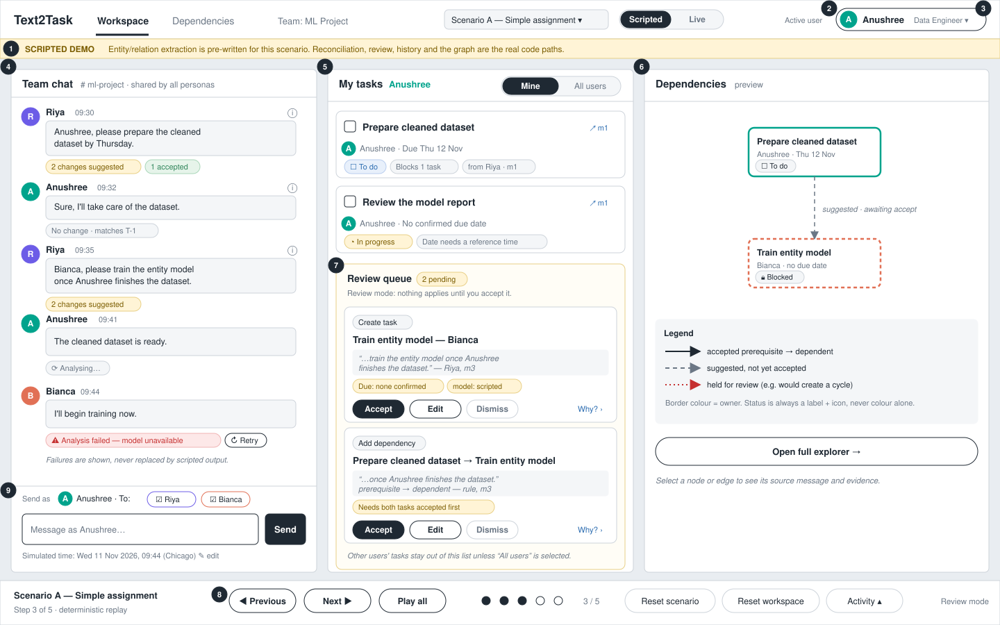
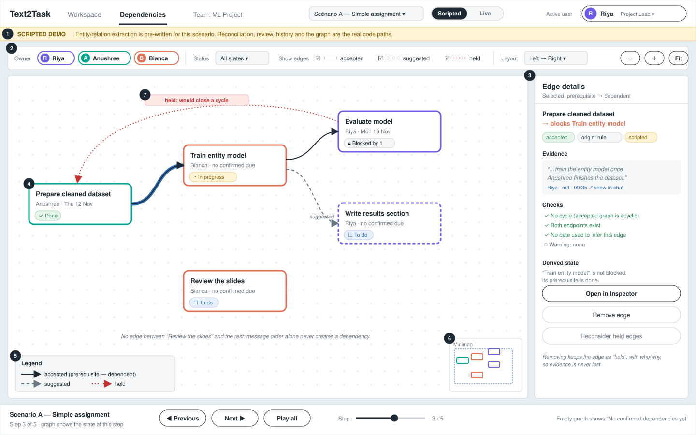
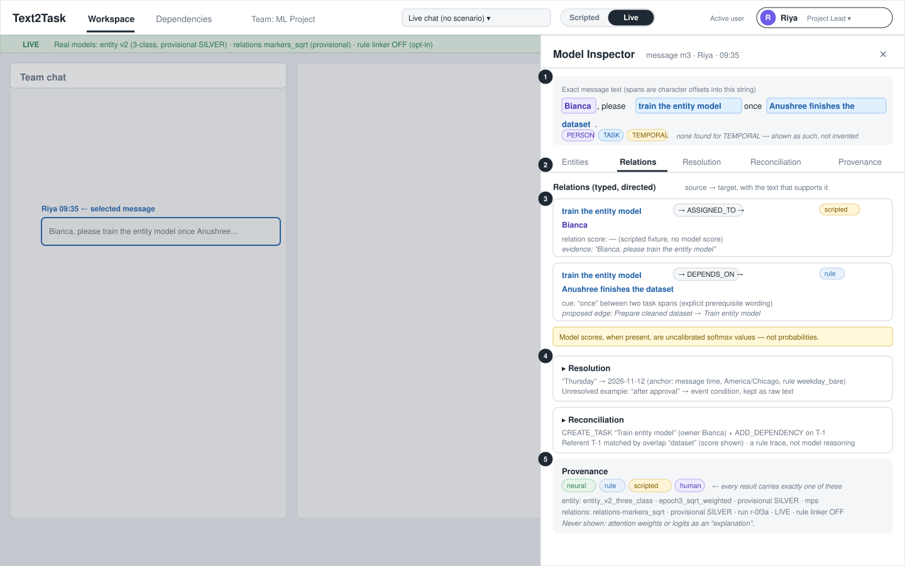
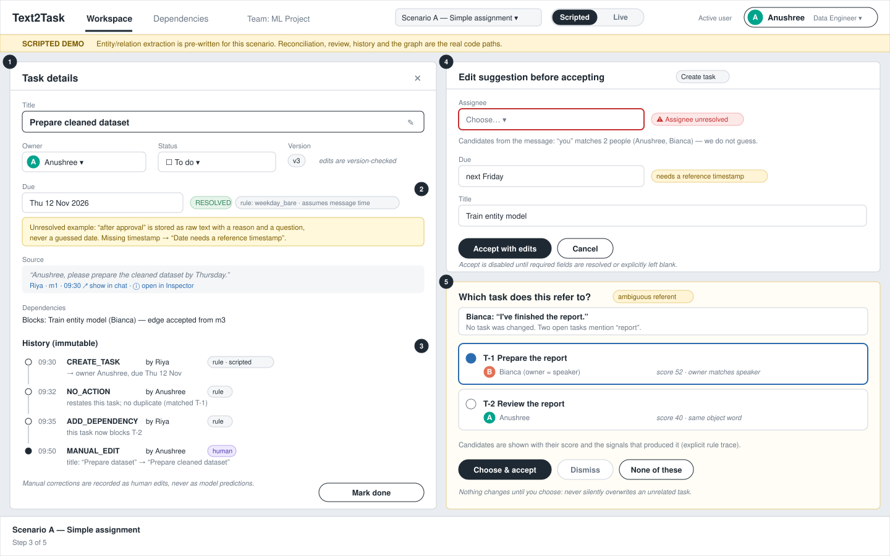
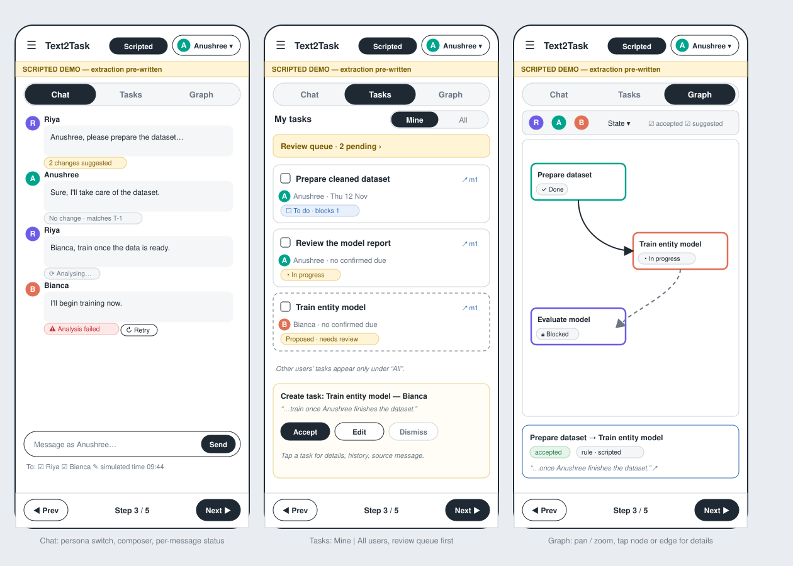
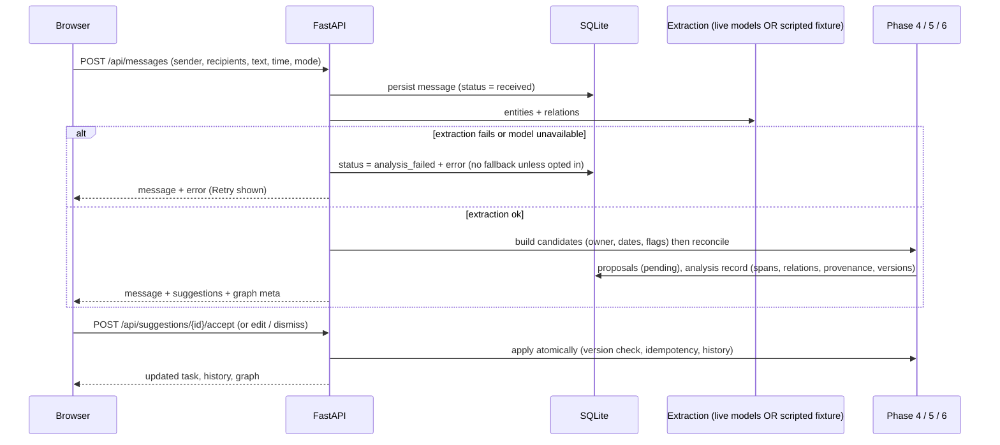

# Phase 7 Plan — Backend Integration and Visualization (Chat, To-dos, Graph, Inspector)

**Status:** Draft for your review. Nothing in this plan has been implemented or installed.
**Sources:** `remaining_phases.md` §8 (Phase 7), `vis_plan.md` (product vision, wireframe layout, scenarios, guardrails, build plan), and the Phase 3 to 6 code as it stands today (253 passing tests).
**Goal:** A local, multi-user chat simulation where a presenter switches between team members, sends messages, and watches the **real pipeline** (entities → relations → dates and owners → reconciliation → graph) turn them into per-user to-dos and cross-user dependencies. Every change is traceable to a source message, and live model output, rules, scripted fixtures and human edits are always visibly distinguishable.

**How this plan follows your UI instructions**

| Your instruction | Where it is honoured |
|---|---|
| Three-column workspace: Chat, My Tasks, Dependencies, AI Inspector as a drawer, scenario controls (`remaining_phases.md` §8) | §5 wireframe 1 and §5.2 |
| Default to review mode; accepted tasks separate from suggestions; missing information shown explicitly | §6.3, §6.5, §9 |
| Live mode shows real output, even mistakes; scripted mode is visibly labelled; never substitute scripted output when live inference fails; rule fallback opt-in or clearly surfaced | §4 (mode separation), §7.3, §10 |
| Include loading, no-task, no-model, inference-error and ambiguous-reference states | §5 wireframes 1 and 4, §6.7 |
| Build order 1 to 5 and the demo acceptance journey (`remaining_phases.md` §8) | §11, §12 |
| `vis_plan.md` non-negotiables, visual style, features 5.1 to 5.5, scenarios A to E, tests, MVP cut line | §3, §6, §8, §10, §13 |
| *Highlight the technologies so I can review them* (your Phase 6 request, applied again) | §2, first thing after this table |

---

## 1. Scope in one paragraph

Phase 7 adds a thin **FastAPI** layer over the existing Python code (it does not rewrite it), a **SQLite** database for the chat and app state next to the Phase 5 task store, and a **React + TypeScript** single-page app. It reuses the Phase 4 candidate builder, the Phase 5 reconciler and the Phase 6 graph without changing their behaviour, except for four small, tested extensions needed so the primary demo journey in `vis_plan.md` (Scenario A) works end to end (§7.4). It does **not** add authentication, notifications, WebSockets, automatic mode, calendars or a trained matcher.

---

## 2. Technologies (please review this section first)

### 2.1 Backend

| Layer | Technology | Status on this machine | Used for | Alternatives considered |
|---|---|---|---|---|
| **API framework** | **FastAPI** | **Not installed** (needs `uv pip install`) | HTTP API, request validation, automatic OpenAPI schema (used to generate frontend types) | Flask (no built-in schema or validation), Django (heavy), plain `http.server` (too much by hand) |
| **ASGI server** | **Uvicorn** | **Not installed** | Runs FastAPI locally on 127.0.0.1 | Hypercorn (no advantage here) |
| **Validation and schemas** | **Pydantic v2** (installed together with FastAPI) | **Not installed** | Request and response models, mirrors the `vis_plan.md` types | `dataclasses` only (no HTTP validation) |
| **Test client** | **httpx** via `fastapi.testclient` | **Installed** | API tests inside the existing `unittest` suite | `requests`; `pytest` (we already use `unittest`) |
| **Persistence** | **SQLite** (`sqlite3`), the existing Phase 5 store plus app tables in the same file | Existing | Participants, messages, analyses, scenario transcripts, tasks, proposals, history, dependencies | PostgreSQL (needless for a local demo), SQLAlchemy (not needed, the store is already written) |
| **Graph** | **NetworkX 3.7** via the Phase 6 `WorkflowGraph` | **Installed** | Cycle checks, blocked/ready states, JSON for the frontend | none, already decided in Phase 6 |
| **ML inference** | Existing **PyTorch 2.15 + Transformers 5.22** (MPS), the Phase 2/3 checkpoints | **Installed** | Entity extraction and neural relations, loaded **once at startup** | none |
| **Language** | Python 3.12 | Installed | everything above | n/a |

**New Python installs: `fastapi`, `uvicorn`, and Pydantic (comes with FastAPI).** Nothing else.

### 2.2 Frontend

| Layer | Technology | Status | Used for | Alternatives considered |
|---|---|---|---|---|
| **Runtime and tooling** | **Node 24.18 + npm 12 / pnpm** | **Already installed** | Build and dev server | none needed |
| **Package manager** | **pnpm** | Installed | Fast, locked installs | npm (works too) |
| **UI framework** | **React + TypeScript** | New (`frontend/`) | The single-page app | Vue, Svelte (`vis_plan.md` specifies React) |
| **Bundler / dev server** | **Vite** | New | Dev server, build, `/api` proxy to FastAPI | Next.js (server framework we don't need) |
| **Styling** | **Tailwind CSS** + design tokens in CSS variables | New | Consistent, accessible styling, dark-mode-ready tokens | Plain CSS modules, MUI (heavy visual opinions) |
| **Accessible primitives** | **Radix UI** (dialog, dropdown, tabs, tooltip, toggle) | New | Keyboard and screen-reader behaviour for drawers, menus and tabs without hand-rolling ARIA | Headless UI, hand-written ARIA |
| **Graph** | **`@xyflow/react` (React Flow)** | New | Interactive nodes, edges, zoom, pan, minimap, selection | Cytoscape.js, vis-network, D3 (more code for the same result) |
| **Graph layout** | **dagre** (`@dagrejs/dagre`) | New | Left-to-right layered layout from the Phase 6 `layer` hint | ELK (better for large graphs, much heavier); Phase 6 caps us at hundreds of nodes |
| **Server state** | **TanStack Query** | New | Fetching, caching and refetching after each action (no WebSockets) | Redux Toolkit (needless), hand-rolled `fetch` hooks |
| **Routing** | **React Router** | New | `/` workspace, `/dependencies`, deep links to a selected task, message or edge | hash-only tab state |
| **Icons** | **lucide-react** | New | Status icons (status is never colour alone) | inline SVG |
| **Fonts** | System font stack | none | No network fetches | Google Fonts |
| **API types** | **openapi-typescript** (dev only) | New | Generates TS types from the FastAPI OpenAPI schema, so frontend and backend cannot drift | Hand-written types |

I will use the latest stable major of each at install time, pinned by the lockfile, and report exact versions when I finish.

### 2.3 Testing and tooling

| Need | Technology | Status |
|---|---|---|
| Backend unit and API tests | stdlib `unittest` + FastAPI `TestClient` (httpx) | Existing pattern |
| Frontend unit and component tests | **Vitest + React Testing Library + jest-dom** | New |
| Accessibility smoke checks | **axe-core** via `vitest-axe` | New, small |
| End-to-end demo acceptance and **screenshots** | **Playwright** (downloads a Chromium, roughly 150 MB) | New; the largest install, see decision 9 |
| Single-command run | `scripts/run_app.sh` (starts Uvicorn, serves the built frontend) | New |

### 2.4 Architecture at a glance



---

## 3. Non-negotiables (from `vis_plan.md`) and how each is enforced

| Rule | Enforcement |
|---|---|
| Switching user changes persona and perspective, **not** workspace state | Persona is client state only. `GET /api/tasks?assignee_id=` filters; there is no "switch user" write endpoint. Test: switching creates or removes nothing. |
| An assignment to someone else appears in **their** list | Tasks carry `owner_id` from Phase 4 identity resolution; "Mine" filters on it. Ambiguous "you" stays unassigned and goes to review. |
| The same task persists across follow-ups | Phase 5 reconciliation and stable `T-n` ids. Test: scenario steps update one task. |
| Arrows always point prerequisite → dependent; message order never creates an edge | Phase 6 contract, serialised as `source = prerequisite`, `target = dependent`. A test sends two ordered messages and asserts no edge appears. |
| Every suggestion, relation and update shows its source message and evidence | Each proposal carries `evidence` and `message_id`; every card links back to the chat. |
| Live, rule, scripted and human results are visibly distinct | Every result has a `source_kind` (`neural`, `rule`, `scripted`, `human`) shown as a chip. Persistent mode banner. See §4. |
| Do not claim the entity model alone predicts ownership, dependencies or reconciliation | The Inspector labels each result with the component that produced it (§6.5). The three-class entity model shows TASK/PERSON/TEMPORAL only; GROUP/EVENT/ARTIFACT are shown as "not produced by the current model". |

---

## 4. Mode separation (Live vs Scripted), the central design decision



- **Scripted** mode scripts only the *extraction* (spans and links). Reconciliation, review, history and the graph are the real code, so scripted demos exercise real state transitions. The banner says exactly that.
- **Live** mode runs the real checkpoints and shows what they produce, including mistakes and empty results. If a model is unavailable, the message is persisted as failed with a **Retry** button (idempotent: Phase 5 replays the same message id without duplicating tasks). It never falls back to scripted output.
- **Rules are always labelled `rule`.** Some capabilities exist only as rules (explicit dependency wording, reconciliation cues). They are used in Live mode and shown as `rule`. A rule *fallback for a failed neural model* is a separate setting, **off by default**, and shown in the banner when on.
- **Human edits** are recorded with `source_kind = human` and never described as predictions.
- All results carry the provisional SILVER disclaimer; nothing is described as GOLD.

---

## 5. Wireframes

The wireframes below are SVG files in `docs/wireframes/` (editable generator scripts in `docs/wireframes/_generator/`). Numbered badges match the tables beneath each image. Wireframes use grayscale plus the three persona accents; **status is always an icon and a label, never colour alone**.

### 5.1 Screen inventory

| Screen / surface | Purpose | Opens from |
|---|---|---|
| **Workspace** (3 columns) | Chat, My Tasks + Review queue, Dependency preview | default route `/` |
| **Dependency Explorer** | Full interactive graph, filters, edge details | tab, or "Open full explorer" |
| **Inspector drawer** | Entities, relations, resolution, reconciliation, provenance | the ⓘ on a message, task, node, edge or suggestion |
| **Task details drawer** | Editable fields, source, dependencies, immutable history | click a task card or node |
| **Edit-suggestion dialog / Referent chooser** | Fix unresolved fields; choose among ambiguous tasks | Review card → Edit; ambiguous suggestions |
| **Scenario drawer + footer controls** | Load, previous, next, play all, reset | header dropdown, footer |
| **Narrow layout** | Chat / Tasks / Graph tabs | screens under about 900 px |

### 5.2 Wireframe 1 — Workspace (desktop, three columns)



| # | Element | Behaviour |
|---|---|---|
| 1 | **Mode banner** | Always visible. Scripted: "extraction is pre-written; reconciliation, review, history and graph are real". Live: model names and versions, "rule linker OFF (opt-in)", "Review mode". |
| 2 | **Scripted / Live toggle** | Live is disabled with a tooltip if the entity model failed to load. |
| 3 | **Active-user switcher** | Changes sender and the "Mine" filter only. |
| 4 | **Team chat** | One shared conversation. Each message shows a status chip: *N changes suggested*, *No change · matches T-1*, *Analysing…*, *Analysis failed, Retry*. ⓘ opens the Inspector. Composer sends as the active persona to chosen recipients; **simulated time** is shown and editable. |
| 5 | **My tasks** | *Mine / All users*. Cards show title, owner, due (or "No confirmed due date"), status, "Blocks N", and a link to the source message. Dashed card = proposed, not yet accepted. |
| 6 | **Dependency preview** | Mini graph with legend and an "Open full explorer" button. |
| 7 | **Review queue** | Suggestion cards: kind, title, evidence quote, flag chips (for example "Date needs a reference timestamp"), **Accept / Edit / Dismiss**, and "Why?". Nothing applies until accepted. |
| 8 | **Scenario controls** | Step *X of Y*, Previous, Next, Play all, Reset scenario, Reset workspace, Activity. |
| 9 | **Composer** | Sends as the active persona; recipients are checkboxes; no auth. |

### 5.3 Wireframe 2 — Dependency Explorer



| # | Element | Behaviour |
|---|---|---|
| 1 | Mode banner | same as above |
| 2 | **Filter toolbar** | Owner chips, status filter, edge kinds (accepted / suggested / held), layout direction, zoom and fit. |
| 3 | **Edge details panel** | Prerequisite → dependent, state chips (accepted, origin `rule`, `scripted`), the **evidence quote** with "show in chat", the checks that passed (no cycle, endpoints exist, no date used to infer the edge), the derived state of the dependent, and *Open in Inspector / Remove edge / Reconsider held edges*. |
| 4 | **Nodes** | Border colour = owner; status is a labelled badge with an icon (Done, In progress, Blocked by N, To do). Dashed border = involved in a suggested edge. |
| 5 | **Legend** | Solid = accepted, dashed = suggested, dotted red = held for review. |
| 6 | **Minimap** | Pan and zoom context. |
| 7 | **Held edge** | A cycle-forming edge is kept visible with its reason, never silently dropped. |

Also: **Step** slider in the footer shows the graph as it was at that scenario step; the empty graph says "No confirmed dependencies yet"; a **"Graph as table"** toggle lists edges as a keyboard- and screen-reader-friendly table.

### 5.4 Wireframe 3 — AI Inspector drawer



| # | Element | Behaviour |
|---|---|---|
| 1 | **Exact message text with entity spans** | Spans are character offsets into the same string. TASK / PERSON / TEMPORAL only (the current model's classes); a missing class says "none found", never invented. |
| 2 | **Tabs** | Entities · Relations · Resolution · Reconciliation · Provenance (progressive disclosure). |
| 3 | **Relations** | Typed and directed (ASSIGNED_TO, DUE_ON, SCHEDULED_ON, DEPENDS_ON), each with its supporting text and a provenance chip. Scores are labelled **uncalibrated softmax**. |
| 4 | **Resolution / Reconciliation** | Raw temporal phrase → normalised value, or "unresolved". Reconciliation shows the operation, the matched task, and the **rule trace** (signals and scores), not model "reasoning". |
| 5 | **Provenance** | `neural` / `rule` / `scripted` / `human`, model versions, run id, mode. Attention weights and logits are never shown as an explanation. |

### 5.5 Wireframe 4 — Task details, edit-before-accept, ambiguous referent



| # | Element | Behaviour |
|---|---|---|
| 1 | **Task details** | Editable title, owner, status; version number (edits are version-checked); source message; dependencies; "Mark done". |
| 2 | **Due field** | Value plus its resolution status and rule. Unresolved values show a reason and a question, for example "Date needs a reference timestamp". |
| 3 | **History** | Immutable timeline with operation, actor, source (`rule`, `scripted`, `human`) and before/after. Manual edits are human edits. |
| 4 | **Edit suggestion** | Unresolved assignee (for example "you" matching two people) is **not guessed**; Accept stays disabled until required fields are resolved or explicitly left blank. |
| 5 | **Referent chooser** | When several tasks match, nothing changes; the candidates are listed with their score and the signals behind it. |

### 5.6 Wireframe 5 — Narrow screens



Below about 900 px the three columns become **Chat / Tasks / Graph** tabs. The persona switcher, mode pill, banner and scenario bar stay in view; the graph keeps pan and zoom; the review queue is the first item in Tasks.

### 5.7 Empty, loading and error states (copy)

| State | Where | Copy |
|---|---|---|
| No tasks yet | Tasks | "No tasks yet. Send a message or load a scenario." |
| No dependencies | Graph | "No confirmed dependencies yet." |
| Assignee unresolved | Card / dialog | "Assignee unresolved: choose who owns this." |
| No timestamp | Due field | "Date needs a reference timestamp." |
| Needs review | Chip | "Suggested change needs review." |
| Analysing | Message chip | "Analysing…" |
| Model unavailable | Banner, Live toggle, message chip | "Model unavailable. Nothing was extracted." |
| Inference failed | Message chip | "Analysis failed. Retry." (the message is kept) |
| Ambiguous reference | Review card | "Which task does this refer to?" |
| Stale edit | Toast | "This task changed. Reload and try again." (HTTP 409) |

---

## 6. Features and behaviour

### 6.1 Multi-user mock chat
Personas **Riya (Project Lead), Anushree (Data Engineer), Bianca (ML Engineer)**; names are editable and a fourth user can be added. One shared conversation. The composer sends as the active persona to one or several recipients. Each message shows sender, time, processing status and a "N changes suggested" chip. Reset workspace and reset scenario are separate. No accounts, notifications or permissions.

### 6.2 Per-user to-dos
Statuses shown: *Proposed / To do / In progress / Blocked / Done / Canceled*. Mapping to the backend:

| UI status | Backend source |
|---|---|
| Proposed | a pending `CREATE_TASK` proposal (not yet a task) |
| To do / In progress / Done / Canceled | task lifecycle `open` / `in_progress` / `completed` / `cancelled` |
| Blocked | **derived** by Phase 6 (`blocked`, or `blocked_cancelled_prereq` shown as "Needs review") |

"Mine" filters by owner; "All users" groups by owner or status.

### 6.3 Suggestions and the review queue
A **suggestion** is a Phase 5 proposal; an **accepted task** is a task row. Mapping:

| `vis_plan.md` suggestion kind | Phase 5 operations |
|---|---|
| `create_task` | `CREATE_TASK` |
| `update_task` | `UPDATE_ASSIGNEE`, `PROPOSE_DUE_DATE_CHANGE`, `CONFIRM_DUE_DATE_CHANGE`, `UPDATE_STATUS`, `COMPLETE_TASK`, `CANCEL_TASK` |
| `add_dependency` | `ADD_DEPENDENCY` |
| `clarification` | ambiguous or missing referent, unresolved owner or date |

Actions: **Accept** → `Reconciler.accept`; **Edit** → accept with edits (owner, date, title, chosen task); **Dismiss** → `Reconciler.dismiss`. Terminal no-ops ("No change · matches T-1") appear as a chip on the message, not in the queue. **Review mode is the default and the only mode built**; the optional automatic mode in `vis_plan.md` is deferred, since softmax scores are not calibrated.

### 6.4 Dependency graph
Phase 6 `to_frontend()` JSON drives React Flow: nodes (owner border, status badge), edges (solid, dashed, dotted red), blocked highlighting, owner/status/edge-kind filters, select node → highlights the task and source message, select edge → evidence and what it blocks. Layout is dagre, left to right, seeded from the `layer` hint, with stable ordering between steps so nodes do not jump. Manual add and remove go through the Phase 6 `GraphEditor`.

### 6.5 AI Inspector
As in §5.4. Evidence spans and explicit rule traces only.

### 6.6 Scenario library
Scenarios A to E from `vis_plan.md` (§9), with **Load, Previous, Next, Play all, Reset** and *Step X of Y*. Fixtures hold messages, scripted extraction and **expected** outcomes, labelled as scripted expectations. In Live mode the same messages can be sent and the *actual* outcome compared with the expectation.

### 6.7 Accessibility and visual rules
- Persona accent colours for avatars and node borders; status is always icon plus label; text contrast at least WCAG AA.
- Full keyboard operation (tabs, menus, dialogs through Radix), visible focus rings, descriptive button names, tooltips for unfamiliar statuses.
- Gentle card insertion and edge reveal; **`prefers-reduced-motion` respected**.
- The graph has a **table alternative** for screen readers and keyboard users.
- Neutral, uncluttered surfaces (the chat is the narrative, tasks are the output, the graph is the explanation).

---

## 7. Backend design

### 7.1 Modules (new, thin; existing code reused)

```
src/api/
  app.py                  create_app(config): lifespan loads the ModelRegistry once
  config.py               paths, db file, default mode, timezone
  schemas.py              Pydantic models (mirror the vis_plan types + Phase 4-6 contracts)
  deps.py                 dependency providers (store, reconciler, registry, services)
  routers/                workspace, messages, tasks, suggestions, dependencies, scenarios, system
  services/
    model_registry.py     loads entity + relation models once; reports real availability and versions
    pipeline.py           message -> entities -> relations -> Phase 4 -> Phase 5 -> persisted analysis
    scenarios.py          fixtures; deterministic load / step / previous / reset
    graph.py              Phase 6 snapshot, editor, impact preview
    chat_store.py         app tables: participants, messages, analyses, scenario state
  fixtures/scenarios/     scenario_a.json ... scenario_e.json
src/model_training/entity_inference.py   entity prediction moved out of a script into the library
frontend/                                React app (see §8)
scripts/run_app.sh, scripts/dev.sh
```

The entity prediction function currently lives in `scripts/evaluate_relation_classifier.py` and the CLI imports it from there. The API must not import from a script, so it moves into `src/` and both callers use it (behaviour unchanged, covered by a test).

### 7.2 API (extends the sketch in `remaining_phases.md` and `vis_plan.md`)

| Method and path | Purpose |
|---|---|
| `GET /api/workspace` | participants, messages, tasks, pending suggestions, graph meta, current mode and scenario step |
| `GET /api/system/capabilities` | which models actually loaded (name, version, provenance, device), fallbacks available, mode support, schema versions |
| `POST /api/messages` | append a message (sender, recipients, text, simulated time, mode) and analyse it |
| `POST /api/messages/{id}/retry` | re-run analysis after a failure (idempotent) |
| `GET /api/messages/{id}/analysis` | entities, relations, resolution, reconciliation trace, provenance, errors |
| `GET /api/tasks?assignee_id=` / `GET /api/tasks/{id}` | task lists and details |
| `PATCH /api/tasks/{id}` | manual edit with `expected_version`; recorded as a human edit (409 on stale) |
| `GET /api/tasks/{id}/history` | immutable history |
| `GET /api/suggestions` | pending (and optionally resolved) proposals |
| `POST /api/suggestions/{id}/accept` | accept, optionally with `edits` and `expected_version` |
| `POST /api/suggestions/{id}/dismiss` | dismiss with a reason |
| `GET /api/dependencies` | Phase 6 frontend JSON (nodes, edges, meta); `?step=` for a scenario step |
| `POST /api/dependencies` / `DELETE /api/dependencies/{edge_id}` / `POST /api/dependencies/{edge_id}/reconsider` | manual graph edits through the Phase 6 editor |
| `GET /api/impact?task_id=&status=` | what-if: which tasks would become ready or blocked |
| `GET /api/scenarios` · `POST /api/scenarios/{id}/load` · `/step` · `/previous` · `/play` · `POST /api/scenarios/reset` | scenario control |
| `POST /api/workspace/reset` | wipe workspace state |
| `PUT /api/settings` | simulated clock, workspace timezone, **opt-in rule fallback** |

Request/response updates plus a refetch are enough (no WebSockets). Errors use a consistent `{code, message, details}` body; stale versions return **409**; unavailable models return **503** with a persisted failed message, never a fabricated result.

### 7.3 Message processing (Live and Scripted share everything after extraction)



Chat messages carry a **simulated timestamp** (default: the current time in the workspace timezone, editable in the header; fixed per step in scripted fixtures). This is the Phase 4 reference time, so relative dates resolve against a real message time, never a silently defaulted one.

### 7.4 Four small Phase 5 extensions needed for the primary demo journey

I walked `vis_plan.md` Scenario A through the current reconciler and found four gaps. Without them the main demo does not work, so I propose closing them with regression tests (no tuning on any held-out data):

| # | Scenario A step | Gap | Proposed extension |
|---|---|---|---|
| a | Step 2: "Sure, I'll take care of the dataset." | **Verified:** it creates a second task, with no duplicate flag, because the word overlap with the existing task is too weak | Recognise an **owner acknowledging an existing task**: the speaker owns exactly one task sharing the object word → `NO_ACTION` (restates T-1) |
| b | Step 3: "…train the entity model **once** Anushree finishes the dataset." | Phase 5 handles "X is waiting on Y" between *existing* tasks and rule edges between two *new* tasks, not a new task whose prerequisite phrase matches an *existing* one | New dependency path: a clause after `once / after / when` that matches an existing task → `ADD_DEPENDENCY` (dependent = the new task, requires its creation first) |
| c | Step 4: "The cleaned dataset is **ready**." | "is ready" is not a completion cue | Add it as a completion cue that, like the others, still needs a matched referent |
| d | Step 5: "I'll **begin** training now." | "begin/start" is not a status cue | Add `I'll begin / start …` as `UPDATE_STATUS → in_progress` |

All four stay conservative (referent required, flagged otherwise). If you would rather not touch Phase 5, the fallback is to reword the scripted scenario to wording the current cues already handle, at the cost of diverging from the `vis_plan.md` script.

### 7.5 Data model (new app tables; Phase 5 tables unchanged)

`participants(id, name, role, color)` · `messages(id, sender_id, recipient_ids, text, created_at, mode, status, error, scenario_step, thread_id, in_reply_to)` · `analyses(message_id, run_id, mode, entities, relations, candidates, proposal_ids, provenance, model_versions, error, duration_ms)` · `scenario_state(scenario_id, step, transcript)` · `settings(key, value)`.
The **transcript** records the review actions taken at each step, so *Previous step* is a deterministic rebuild: reset, then replay steps 1 to N-1 with the recorded actions. History timestamps come from the injectable audit clock (fixed per step in scripted mode).

### 7.6 Model loading and capabilities
`ModelRegistry` loads the entity and relation checkpoints once at startup and exposes **actual** availability (`loaded`, `device`, `version`, `provisional`, `error`). The Live toggle and banner read this. A health check never reports a model as ready that failed to load.

---

## 8. Frontend structure

```
frontend/
  package.json  vite.config.ts  tsconfig.json  tailwind config  index.html
  src/
    main.tsx  App.tsx  routes
    api/            client.ts, types.ts (generated from OpenAPI), hooks (TanStack Query)
    state/          persona context, UI state (drawer, selection, filters)
    components/     ModeBanner, StatusBadge, ProvenanceChip, UserAvatar, EmptyState, ErrorState, EvidenceQuote
    features/
      chat/         ChatPanel, MessageBubble, MessageComposer, ScenarioControls
      tasks/        TaskPanel, TaskCard, TaskDetails, ReviewQueue, SuggestionCard, EditSuggestionDialog, ReferentChooser
      graph/        DependencyPreview, DependencyExplorer, TaskNode, DependencyEdge, EdgeDetails, GraphToolbar, GraphTable
      inspector/    InspectorDrawer, SpanHighlighter, RelationsTab, ResolutionTab, ReconciliationTab, ProvenanceTab
    styles/         tokens.css (persona accents, status tokens, spacing, focus ring)
  tests/            Vitest + Testing Library
  e2e/              Playwright demo journey and screenshots
```

---

## 9. Scenarios (fixtures)

| ID | From `vis_plan.md` | Highlights |
|---|---|---|
| **A** | Simple assignment (MVP) | Assign → acknowledge (no duplicate) → dependent task + edge → completion unblocks → "I'll begin training" updates the existing task |
| **B** | Deadline change | Assign → *proposed* move (Friday stays active) → "Friday is fine" confirms; one task, one history |
| **C** | Ambiguity | "Can someone review the slides?" → unassigned suggestion → "I can review them" → match options shown, not guessed |
| **D** | Non-actionable | "The server went down yesterday." and "The request was rejected." create nothing; "Please investigate why the server went down." creates a task |
| **E** | Dependency conflict | A → B accepted, then B → A is **held with the cycle path**; accepted graph stays valid |

Each fixture lists messages, scripted extraction, and expected outputs and state changes, and is presented as **scripted expectations, not model predictions**. *Play all* uses a clearly labelled "simulated reviewer"; stepping manually leaves proposals for the presenter to accept.

---

## 10. Guardrail tests (from `vis_plan.md` §10, plus ours)

| Must hold | Test layer |
|---|---|
| User switch creates or removes no messages or tasks | API + UI |
| Source ids and evidence stay attached after a task update | API |
| Repeated messages and restated requests create no duplicate when a match is confirmed | API (reuses Phase 5) |
| A proposed deadline change does not alter the due date until confirmed | API + E2E |
| "Yesterday's failure" does not become a to-do | scenario D |
| Dependency arrows point prerequisite → dependent; message order creates no edge | API + UI |
| Blocked state updates on complete / reopen / cancel | API + UI |
| Cycle detection prevents accepting a cyclic edge; the held edge stays visible | scenario E |
| Graph works with zero, one and many nodes | UI |
| **Scenario reset and *Previous step* restore the exact state** | API + E2E |
| **Live mode fails visibly when a model is unavailable; scripted output never appears in Live mode** | API (fake registry) |
| Human edits keep human provenance; SILVER is never described as GOLD | API + UI |
| Stale version edits are rejected (409) and nothing is written | API |
| Keyboard operation and axe checks on the main surfaces | UI |

---

## 11. Build order and gates (follows `remaining_phases.md` §8)

| Step | Work | Gate |
|---|---|---|
| **0. Prerequisites** | Install FastAPI, Uvicorn; move entity inference into `src/`; the four Phase 5 extensions (§7.4) with tests; the `frontend/` scaffold | existing 253 tests still pass |
| **1. Scaffold + scripted vertical slice** | App factory, DB tables, Pydantic contracts, scenario service with Scenario A scripted extraction; chat, persona switch, simple task list | **Checkpoint 1:** a scripted message becomes a task under the right user in the browser |
| **2. Tasks, review, history** | Task panels, review queue, edit dialog, referent chooser, task details and history, manual edits | proposals appear, accept/edit/dismiss works, 409 handled |
| **3. Graph** | Preview, Explorer, React Flow with Phase 6 JSON, blocked states, held edges, graph table, manual edit | **Checkpoint 2:** Scenario A shows the edge, completion unblocks, a cycle is held |
| **4. Live inference** | Model registry, capabilities, pipeline service, failure and retry, rule-fallback setting, Inspector data | **Checkpoint 3:** live messages produce *actual* spans and results, with visible failures |
| **5. Inspector, playback, polish** | Inspector UI, scenarios A to E, Previous-step rebuild, narrow layout, accessibility, E2E, screenshots, `run_app.sh` | demo acceptance and all guardrail tests pass |

I will stop and report at each checkpoint.

---

## 12. Demo acceptance (from `remaining_phases.md` §8)

Switch between three participants; send an assignment; review the extracted suggestion; verify the task appears in the intended user's list; add an explicit dependency; update a deadline without creating a duplicate; complete the prerequisite and watch the graph update. **Repeat in Live mode** and show the raw predictions and any corrections honestly. Deliverables: runnable local app, scenario fixtures, setup instructions, test results, and demo screenshots.

## 13. MVP cut line and deferrals (from `vis_plan.md` §11)

**Essential:** shared chat with persona switcher; per-user to-dos with source links; Scenario A playback; review queue; directed graph with blocked state; visible Demo/Live and an Inspector with real data when available.
**If time permits:** deadline-change scenario (B), activity timeline, compact evaluation panel, richer animations.
**Deferred:** authentication, real multi-device messaging, notifications, calendar integration, automatic apply mode, critical-path analysis, conversation threads/channels, trained coreference, WebSockets.

## 14. Definition of done (maps to `remaining_phases.md` §11 Phase 7 items)

- [ ] FastAPI exposes **actual** inference and persists workspace state.
- [ ] Chat, participant switching, personal to-dos, review queue and graph are integrated.
- [ ] The Inspector exposes real predictions, evidence, model versions and corrections.
- [ ] Scripted scenarios and live inference are clearly separated, and the separation is tested.
- [ ] Loading, no-task, no-model, inference-error and ambiguous-reference states exist.
- [ ] Automated tests pass (existing 253 plus new), an end-to-end demo passes, and setup instructions are documented.

---

## 15. Decisions to confirm before implementation

Each has a default. Tell me which to change.

1. **Frontend stack:** React + TypeScript + Vite + Tailwind + Radix primitives. *(default)*
2. **Package manager:** pnpm (already installed). *(default; npm also works)*
3. **Graph layout:** dagre. ELK is heavier; Phase 6 limits us to hundreds of nodes. *(default: dagre)*
4. **Server state:** TanStack Query only, no Redux or Zustand. *(default)*
5. **Routing:** React Router for `/`, `/dependencies` and deep links. *(default)*
6. **Type safety:** generate TypeScript types from the FastAPI OpenAPI schema with `openapi-typescript`. *(default: yes)*
7. **How the demo runs:** `scripts/run_app.sh` serves the built frontend from FastAPI (one command); `scripts/dev.sh` runs Vite plus Uvicorn for development. *(default)*
8. **Default workspace timezone:** the browser's timezone, editable in the header. Simulated time defaults to the current time in that zone, editable. *(default)*
9. **Playwright for end-to-end tests and screenshots:** about 150 MB Chromium download. *(default: include, because "demo screenshots" are a deliverable; alternative: skip it and take screenshots by hand)*
10. **Phase 5 extensions (§7.4):** close the four gaps with tests so Scenario A works as written. *(default: yes; alternative: reword the scripted scenario)*
11. **Rule fallback for a failed neural model:** opt-in setting, **off by default**, shown in the banner when on. *(default)*
12. **Automatic apply mode:** not built; review mode only. *(default)*
13. **Personas:** Riya, Anushree, Bianca, editable, with an optional fourth user. *(default)*
14. **Scenarios shipped:** A and B first, then C, D, E. *(default: all five)*

## 16. Risks

| Risk | Mitigation |
|---|---|
| Live extraction on short chat messages is weak (we saw split date spans and empty results) | Show it honestly; the Inspector makes mistakes visible; scripted mode exists for reliable demos and is always labelled. |
| Scenario A needs the four Phase 5 extensions | Small, tested, conservative; fallback is rewording the script (decision 10). |
| New installs (FastAPI, Node packages, Playwright) | Listed in §2; installs only after approval; Playwright is optional. |
| Model loading time and memory (MPS) at startup | Load once; capabilities endpoint reports `loading`; the UI shows it; Live toggle disabled until ready. |
| Mode confusion (scripted looks like live) | Persistent banner, per-result provenance chips, and a test that scripted output never appears in Live mode. |
| Synchronous inference blocks the server thread | Short messages run in well under a second on MPS; a single worker is enough for a local demo; the message is persisted before inference. |
| Graph layout jumps between steps | Stable ordering and transitions; layout inputs are deterministic. |
| Scope growth | The MVP cut line in §13 is binding; everything else is a stretch goal. |

## 17. Out of scope

Authentication and permissions, multi-device messaging, notifications, calendar integrations, WebSockets, automatic apply mode, critical-path analysis, EVENT/external dependency nodes, training any new model, and any human-reviewed GOLD data.
