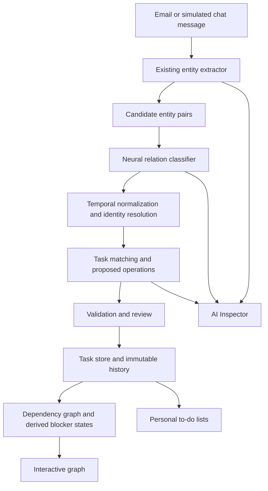

# Text2Task — Remaining Implementation Phases

**Status baseline:** 15 November 2026  
**Scope:** Neural relation extraction onwards, with the outstanding entity-quality work retained as a parallel track.  
**Companion documents:** `masterplan.md`, `vis_plan.md`, latest Text2Task ML Project Progress report.

## 1. Remaining work at a glance

The MailEx ingestion, cleaning, annotation infrastructure, model-ready dataset preparation, rule baseline and DistilBERT entity training are already implemented. The strongest entity checkpoint is provisional: leakage-corrected development lenient F1 is 0.555 (strict F1 0.390), compared with the rule baseline of approximately 0.401 lenient F1. No relation classifier has been trained, no independent GOLD evaluation set exists, and the improved workflow's test split remains untouched. The report records 113 passing tests. Application components below are planned, not confirmed implementations.

| Workstream | Remaining deliverable | Priority |
|---|---|---|
| Entity quality (parallel) | Leakage-free rebuild, human-reviewed references, frozen checkpoint | Essential for final claims |
| Phase 3: Neural relations | Trained pair classifier and rule comparator | Essential |
| Phase 4: Temporal and uncertainty | Normalized dates, unresolved fields, review routing | Essential |
| Phase 5: Reconciliation | Persistent tasks and safe follow-up updates | Essential |
| Phase 6: Dependency engine | Validated graph, blocker states and edge evidence | Essential |
| Phase 7: Application | FastAPI, mock chat, personal to-dos, graph and inspector | Essential for demo |
| Phase 8: Evaluation | Held-out results, comparative experiments and error analysis | Essential |

**MVP cut line:** An actual model processes a message, proposes tasks and relationships, users can correct them, accepted tasks appear in personal lists, follow-ups update stable task IDs, and explicitly supported dependencies appear in the graph. Advanced calibration, full cross-thread coreference, six-class expansion and automatic global constraint optimization are extensions, not prerequisites for a working application.

## 2. Target architecture



Every component should expose a stable interface and provenance. Rules, neural predictions, scripted fixtures and human corrections must be distinguishable. Keep the existing ML code and add adapters instead of rewriting the pipeline.

## 3. Parallel workstream — Entity quality and evaluation readiness

Do not wait for perfect NER before implementing downstream modules. However, do not designate the current checkpoint as final or interpret provisional metrics as human-grounded accuracy.

- Rebuild train/development splits using thread membership and cross-split exact/near-duplicate checks **before** checkpoint selection and retraining. The earlier rescoring removed copied development emails but cannot undo their influence on training decisions.
- Freeze manifest hashes, preprocessing policy, label mappings, seed and checkpoint identifiers. Check the untouched test split for contamination before final evaluation without using its semantic labels to tune the model.
- Create a human-reviewed evaluation subset, following the revised annotation guidelines. Review missing spans as well as existing labels, including no-task examples and relations. Record actual reviewer identity/status; do not promote automated corrections to GOLD.
- Improve missing request annotations and conservative person/date coverage if needed. Reuse the three-label TASK/PERSON/TEMPORAL architecture; do not force GROUP, EVENT or ARTIFACT expansion without sufficient evidence.
- Freeze one checkpoint using development data only. Multiple seeds and cased-model comparisons are useful extensions when time permits.

**Deliverables:** versioned clean manifests, quality report, GOLD evaluation subset, pinned checkpoint and inference contract. If GOLD is not available, retain an explicitly provisional mode and block final human-grounded metrics.

## 4. Phase 3 — Neural relation extraction

### Objective

Determine which detected task is associated with each owner, time expression or explicit prerequisite. The existing entity extractor answers “what spans exist?”; the relation classifier answers “how are these spans connected?”

### Inputs and output

Reuse `src/model_data/relation_classification.py`, `scripts/prepare_relation_classification.py` and the existing relation exports under `data/model_ready/`, after verifying compatibility with the latest three-class checkpoint and annotation versions.

| Label | Directed relation | Example |
|---|---|---|
| ASSIGNED_TO | TASK → PERSON (or GROUP when supported) | submit report → Riya |
| DUE_ON | TASK → TEMPORAL | submit report → Friday |
| SCHEDULED_ON | TASK → TEMPORAL | review report → Monday at 10 |
| DEPENDS_ON | TASK → prerequisite TASK/EVENT | submit report → approve draft |
| NONE | Type-compatible pair with no annotated link | unrelated date or person |

`NONE` is a classification outcome, never a stored graph edge. Because labels are incomplete, an unannotated pair is not necessarily a true negative. Use reviewed negatives where possible and flag uncertain pairs; report weak-negative assumptions in provisional training.

The current model cannot produce GROUP, ARTIFACT or EVENT spans. Start with task-person, task-time and task-task relations. Only support EVENT endpoints through a separately validated detector or an explicitly reviewed/manual fallback. Do not claim a full six-class end-to-end system.

### Implementation steps

1. **Audit the relation dataset.** Count positive examples per relation, inspect evidence and offsets, confirm label definitions, check duplicate groups and thread-disjoint membership. Rebuild candidate pairs if the prior export is incompatible with revised labels. Ensure all positives survive sampling.
2. **Establish a rule comparator.** Link explicit addressees and nearby dates conservatively; distinguish `by`/deadline from scheduled execution; require clear prerequisite evidence. Retain unresolved cases.
3. **Prepare model input.** Mark both entities in the original context, e.g. `[PERSON] Riya [/PERSON] should [TASK] submit the report [/TASK] by Friday`. Define source/target direction explicitly, verify marker tokenization and resize embeddings if adding vocabulary tokens. Keep both entities in the input window; flag unrepresentable distant pairs.
4. **Train a sequence classifier.** Use a pretrained DistilBERT encoder and `AutoModelForSequenceClassification`. Start with a modest batch size, gradient accumulation, fixed seed, learning rate around 2e-5 to 5e-5 and a short development-controlled run. Select using positive-relation development F1, not overall accuracy dominated by NONE. If a pair can genuinely have multiple labels, define a multilabel policy or document a mutually exclusive MVP policy before training.
5. **Evaluate in two modes.** First use reference entity spans to isolate relation learning; then real predicted spans to measure error propagation. Reference SILVER spans are not GOLD. Evaluate held-out candidate sets without silently dropping difficult pairs or artificially balancing away deployment negatives.
6. **Expose inference.** Accept text, span IDs, types and offsets; return typed relations with scores, source/target IDs, evidence text and model version. Preserve no-link decisions and unresolved cases for debugging.

### Proposed deliverables

- `src/model_training/relation_classifier.py`
- `scripts/train_relation_classifier.py`, `scripts/evaluate_relation_classifier.py`, `scripts/predict_relations.py`
- `configs/relation_training.yaml`, `models/text2task-relations/`, `results/relation_extraction/`

Adapt names to the existing repository rather than duplicating modules.

### Acceptance criteria

- Type-valid pair construction and deterministic split checks pass.
- A real checkpoint and actual predictions exist; precision/recall/F1 are reported per relation and micro/macro, with NONE handled explicitly.
- Rule versus neural results are compared on the same evaluation examples. Separately report end-to-end span-plus-relation performance and candidate coverage.
- Sparse relations are disclosed; if DEPENDS_ON lacks sufficient supervision, retain a clearly labeled rule/manual path and limit neural claims.

## 5. Phase 4 — Temporal normalization, identity resolution and uncertainty

### Objective

Convert extracted text into actionable task fields without inventing dates or people. This stage is mainly deterministic; it does not require training another model.

### Implementation

- Normalize date/time expressions using a library such as `dateparser` with an explicit message timestamp and timezone. Preserve the raw expression, normalized value, granularity (date versus datetime), and resolution status.
- Keep `due_at` and `scheduled_at` separate. Do not default to the current machine date when an email has no reliable timestamp. Expressions such as “after approval” remain unresolved event conditions unless linked to a known prerequisite.
- Map named assignees to workspace participant IDs using exact aliases or confirmed matches. Resolve `I` to the sender only when the task is their commitment; resolve `you` only when a single intended addressee is supported. Otherwise use an unassigned state and review.
- Use conservative rule-based uncertainty flags for ambiguous identity, competing dates, weak relation scores or unsupported prerequisites. Raw softmax scores are not calibrated probabilities. Calibrate or tune abstention thresholds on reviewed development data if available; otherwise keep review mode as the default.
- Generate actionable clarification questions, e.g. “Who should review the draft?” or “Which Friday did you mean?”

### Proposed deliverables and completion

`src/temporal/normalize.py`, `src/pipeline/identity_resolution.py`, `src/pipeline/uncertainty.py` and unit tests. Tests cover relative dates, timezone, missing metadata, ambiguous dates, different scheduling/deadline relations, multiple recipients and no-assignee cases. Every unresolved field must survive into the API instead of being silently guessed.

## 6. Phase 5 — Task reconciliation and lifecycle

### Objective

Maintain one persistent task for the same work as conversation turns establish, discuss, update or close it. The entity model extracts spans, not task identity or update intent; implement a separate context-aware reconciliation module.

### Task state contract

Each record needs a stable `task_id`, title, owner ID (nullable), due and scheduled fields, lifecycle status, source message ID, evidence, version and provenance. Store dependency edges separately. Keep `blocked` as a derived graph condition rather than overwriting the underlying lifecycle status.

### Reconciliation algorithm

1. Retrieve candidate tasks from the same workspace/thread using explicit IDs, referenced messages, normalized action/object phrases, owner and recency. Optional local sentence embeddings can assist matching, but must not override direct evidence.
2. Detect operation intent from current text and context: CREATE_TASK, UPDATE_ASSIGNEE, PROPOSE_DUE_DATE_CHANGE, CONFIRM_DUE_DATE_CHANGE, UPDATE_STATUS, COMPLETE_TASK, CANCEL_TASK, ADD_DEPENDENCY or NO_ACTION. Treat simple historical statements as non-creation events. Completion or cancellation still needs positive reference evidence.
3. Compare candidates using transparent matching signals. When there is no clear referent or several plausible matches, ask for review rather than modifying an unrelated record. Detect repeated requests and repeated message submissions.
4. Construct a proposed change; validate owner/date/status and dependency consistency. Keep proposed changes separate from accepted task state. In review mode, approve/edit/dismiss before applying.
5. Apply the accepted change atomically using task version checks and an idempotency key. Append immutable history containing message ID, task ID, actor, before/after values, operation, timestamp and source kind.
6. Refresh task lists and graph state without changing the stable task ID.

### Example

| Message | Expected operation | Result |
|---|---|---|
| Riya: “Bianca, prepare the report by Friday.” | CREATE_TASK | Task T1 assigned to Bianca |
| Riya: “Could we move it to Monday?” | PROPOSE_DUE_DATE_CHANGE | Friday stays active; Monday pending |
| Bianca: “Monday works.” | CONFIRM_DUE_DATE_CHANGE | T1 deadline becomes Monday if context is unambiguous |
| Bianca: “I've finished the report.” | COMPLETE_TASK | T1 completed, no additional task |
| Bianca: “The API failed yesterday.” | NO_ACTION | No task created without a new instruction |

### Proposed deliverables and completion

`src/reconciliation/matcher.py`, `operations.py`, `reconciler.py` and `tests/test_reconciliation.py`. Demonstrate stable IDs, duplicate prevention, ambiguous-reference review, rejected proposals, reassignment, cancellation, completion and traceable corrections. The MVP is a conservative heuristic state machine, not a newly trained coreference model.

## 7. Phase 6 — Dependency graph and consistency-aware inference

### Objective

Represent cross-user prerequisites and derive workflow readiness. Use NetworkX as the backend graph implementation.

### Graph contract

- Nodes represent accepted task IDs; validated prerequisite events may be represented as separate nodes when supported.
- A relation `T2 DEPENDS_ON T1` becomes a graph edge **T1 → T2** (prerequisite to dependent).
- Every edge retains evidence, source message, source kind, relation score if available and accepted/proposed status.
- A task is ready when all required prerequisites are satisfied and it is otherwise open; it is blocked when at least one required prerequisite is incomplete. Cancellation does not automatically satisfy a prerequisite; flag it for review.

### Implementation

- Validate endpoints, prevent self-dependency and detect cycles before accepting strict prerequisite edges. Preserve rejected/proposed edges and the reason; do not silently delete predictions.
- Support task creation, edge addition/removal, task completion/cancellation, predecessor queries and topological ordering only for acyclic graphs.
- Flag logically incompatible known timing constraints where justified. Do not assume temporal order is dependency, or that all work must have one owner or deadline.
- Provide graph serialization with node/edge IDs, owner, evidence and derived status for the frontend.
- Optional research extension: compare independently accepted relation predictions against a consistency-aware edge selection algorithm. Keep evidence and thresholds fixed; measure both incorrect edges removed and correct edges lost. A graph visualization alone cannot improve semantic extraction F1.

### Proposed deliverables and completion

`src/graph/graph_builder.py`, `graph_constraints.py`, `workflow_state.py` and graph tests. Show a multi-user chain where completing a prerequisite unblocks the next task, and demonstrate that a proposed cycle is flagged without corrupting accepted state.

## 8. Phase 7 — Backend integration and visualization

### Objective

Connect the real ML pipeline to a usable multi-user chat simulation. Follow `vis_plan.md` for detailed UI design; implement a minimal vertical slice first.

### Backend

Use FastAPI and SQLite for a local MVP. Store workspace participants, messages, extraction records, tasks, suggestions, dependencies and history. Load model checkpoints once, expose their actual availability and version, and attach provenance to every prediction. A message should be persisted even if inference fails; allow retry without duplicate tasks.

Suggested API surface:

```text
GET  /api/workspace
GET  /api/system/capabilities
POST /api/messages
GET  /api/messages/{id}/analysis
GET  /api/tasks?assignee_id=...
GET  /api/dependencies
GET  /api/suggestions
POST /api/suggestions/{id}/accept
POST /api/suggestions/{id}/dismiss
GET  /api/tasks/{id}/history
POST /api/scenarios/{id}/load
POST /api/scenarios/{id}/step
POST /api/scenarios/reset
```

Add a manual edit endpoint with version checks and history. Request/response updates are sufficient for a local simulator; WebSockets and authentication are optional. Simulated user switching is not authentication.

### Frontend

Use React + TypeScript (Vite), with React Flow for the graph. Build a three-column workspace:

| Area | Required behaviour |
|---|---|
| Chat | Shared conversation, active sender switching, message timestamps, send/retry |
| My Tasks | Per-user and all-users views, status, deadline, source, accept/edit/dismiss |
| Dependencies | Owner-colored nodes, directional arrows, blocked/ready/done styling, node selection |
| AI Inspector (drawer) | Highlight raw model spans, relation evidence/scores, normalization and operation history |
| Scenario controls | Load, next message, reset/replay; expected outcomes for scripted tests |

Default to review mode while models remain provisional. Keep accepted tasks separate from suggestions and show missing information explicitly. Include loading, no-task, no-model, inference-error and ambiguous-reference states.

**Mode separation:** Live mode runs the real checkpoint and displays actual outputs, even mistakes. Scripted mode uses visibly labeled fixtures for deterministic demonstrations. Never substitute scripted output when live inference fails. Rule-based fallback must be opt-in or clearly surfaced.

### Build order

1. Scaffold API, database and shared contracts plus a scripted chat-to-task vertical slice.
2. Implement task panels, suggestion review and history.
3. Integrate interactive graph and derived blocked states.
4. Connect entity and relation inference, temporal normalization and reconciliation adapters.
5. Finish inspector, scenario playback, API/UI integration tests and clean presentation styling.

### Demo acceptance

Switch between three participants, send an assignment, review the extracted suggestion, verify the task appears in the intended user's to-do list, add an explicit dependency, update a deadline without creating a duplicate, complete the prerequisite and observe the graph update. Repeat in live mode and show raw predictions and any corrections honestly.

## 9. Phase 8 — Final evaluation and deliverables

### Research experiments

Freeze evaluation data, metric definitions and model versions before final testing. Use a consistent reviewed reference subset where possible. If GOLD remains unavailable, report results specifically as provisional agreement with SILVER/MailEx-derived labels and do not claim human-grounded accuracy.

| Experiment | System | What it measures |
|---|---|---|
| E1 | Rule extraction + rule linking | Basic baseline |
| E2 | Neural entity extraction + rule linking | Contribution of learned span extraction |
| E3 | Neural extraction + neural relation classifier | Contribution of learned linking |
| E4 | E3 + graph representation | Workflow reconstruction and downstream usefulness |
| E5 (optional) | E4 + consistency-aware edge selection | Effect of actual constraint-based inference |
| E6 (optional) | Confidence/clarification and abstention | Reliability versus coverage |

### Metrics and test sets

- Entity strict and lenient span precision/recall/F1, by label, using fixed matching thresholds and evaluation population.
- Relation precision/recall/F1 by type, reference-span versus predicted-span evaluation, candidate recall and dependency-edge F1. Report denominator/support for each rare class.
- Task-record accuracy for title/owner/date, exact-record match where appropriate; separate normalized date results from missing timestamp cases.
- Reconciliation operation accuracy, duplicate creation rate, incorrect overwrite count, ambiguous-update handling and stable task identity.
- Graph constraint violations/cycles, blocked/ready accuracy, accepted edge precision/recall and unresolved edges. Do not conflate graph validity with semantic accuracy.
- A small human-reviewed chat scenario set alongside email evaluation to assess domain shift. Scripted fixtures are functional tests, not independent ML benchmarks; distinguish them from live predictions.
- Review acceptance/abstention coverage and false auto-apply decisions if automatic mode is enabled.

### Final artifacts

Pinned checkpoints and configuration; split manifests; annotation provenance; evaluation report with predictions and negative results; architecture diagram; runnable local application; scenario fixtures; reproducible setup and inference instructions; test results; report and demo screenshots. Report remaining limitations, including label incompleteness, single-seed results if unchanged, missing entity classes and untrained or unsupported relations.

## 10. Execution order and decision gates

| Gate | Evidence required | Can parallel work continue? |
|---|---|---|
| G1: Relation readiness | Audited compatible pairs, labels, split and class support | Yes: temporal, graph and UI fixtures |
| G2: Relation inference | Saved trained checkpoint and actual provisional predictions, or explicit limited fallback | Yes: reconciliation and API |
| G3: End-to-end MVP | Persisted chat → reviewed task → graph → lifecycle update | Yes: evaluation preparation |
| G4: Final evaluation | Leakage-free selected checkpoints, independent GOLD references and frozen held-out protocol | Demo may proceed provisionally; final claims cannot |

**Recommended immediate action:** audit and rebuild the relation dataset for the current three-class entity model, implement the rule comparator, and train the first relation classifier in provisional mode if supervision is adequate. Begin deterministic temporal parsing, task store and graph logic in parallel. Avoid expanding NER or training an additional reconciliation model until the end-to-end system works.

## 11. Definition of done

- [ ] Relation dataset audited and compatible with the chosen entity checkpoint.
- [ ] Neural relation model trained and evaluated, or unsupported relation functionality explicitly limited and labeled.
- [ ] Temporal normalization, identity resolution and review routing work on realistic examples.
- [ ] Task reconciliation preserves identity and records changes without accidental duplication.
- [ ] Dependency graph validates edges and derives blocker states correctly.
- [ ] FastAPI exposes actual inference and persists workspace state.
- [ ] Chat, participant switching, personal to-dos, review queue and graph are integrated.
- [ ] AI Inspector exposes real predictions, evidence, model versions and corrections.
- [ ] Scripted scenarios and live inference are clearly separated.
- [ ] Final evaluation and report distinguish provisional results from human-reviewed results; limitations are disclosed.
- [ ] Automated tests and an end-to-end demo pass with documented setup instructions.
